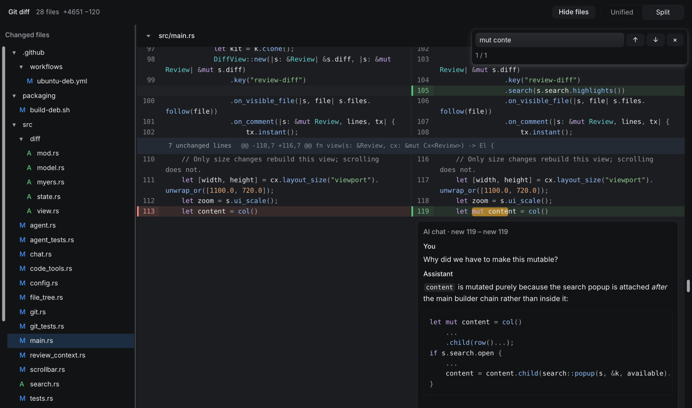

# Margin

Software development is now about prompting agents and reviewing their work with their help. Margin let's you do that, you can use it just like you would use git diff, it displays the diff and you can ask your favorite LLM what the code that it has just written does.



## Install on Ubuntu 26.04

Download the amd64 `.deb` from the [latest release](https://github.com/gjolly/margin/releases/latest). In the directory containing the download, install it with:

    sudo apt install ./margin_*.deb

APT installs Git and common font, keyboard, and Vulkan libraries. The display dependencies accept either a complete Wayland or X11 client stack. APT reuses a complete installed backend; if neither is installed, it defaults to Wayland. It selects from installed packages, not the current desktop session. GPU drivers may have their own display-library dependencies. For an X11 desktop missing client libraries, install its complete backend explicitly alongside the package:

    sudo apt install libx11-xcb1 libxcursor1 libxi6 libxkbcommon-x11-0 ./margin_*.deb

Run `margin` from the repository you want to review. This package targets Ubuntu 26.04 on amd64; older Ubuntu versions are not supported. Your desktop session still needs working Vulkan drivers for its GPU.

## Install on NixOS

With flakes enabled, install directly from GitHub:

    nix profile add github:gjolly/margin

Then run `margin` from the repository you want to review. You can also run it without installing, from that repository:

    nix run github:gjolly/margin -- --cached

To install declaratively, add an input to your system or Home Manager flake:

```nix
inputs.margin.url = "github:gjolly/margin";
```

In a module that has access to your flake's `inputs`, use:

```nix
environment.systemPackages = [ inputs.margin.packages.${pkgs.stdenv.hostPlatform.system}.default ];
# Home Manager: use home.packages instead of environment.systemPackages.
```

Pass `inputs` to NixOS modules through `specialArgs = { inherit inputs; };`, or to Home Manager modules through `extraSpecialArgs = { inherit inputs; };`. Keep Margin's pinned nixpkgs input for the tested compiler and libraries. The package builds in release mode, runs non-rendering tests, and includes Git and library lookup in its launcher. No development shell is needed to use it. The flake declares x86-64 and ARM64 Linux; ARM64 has not been tested. A desktop session with working Vulkan drivers is required.

## Build and run on NixOS

From this project:

    nix develop -c cargo build --release --locked
    nix develop -c cargo run --release --locked

The viewer runs Git in its current working directory. To inspect another repository, enter the development shell and invoke the binary there:

    nix develop
    cargo build --release --locked
    export PATH="$PWD/target/release:$PATH"
    cd /path/to/repository
    margin
    margin --cached
    margin HEAD~1 HEAD
    margin main...HEAD -- src/
    margin --no-index old.txt new.txt

Arguments are passed directly to Git, preserving the -- path separator and shell-quoted paths. With no arguments, this shows tracked working-tree changes against the index, just like git diff. Untracked files are not included. Split view is the default; the toolbar can switch to unified view. Use the release build for interactive use: the default debug build leaves Rune's layout, text shaping, and rendering code unoptimized and can scroll slowly.

The viewer controls patch formatting (no colors, external diff helpers or textconv). Output-only modes such as --name-only, --raw, --check and --output are rejected. Rune demo flags such as --scene and --snap are no longer accepted. Git runs once after the first frame; this is a snapshot, with no automatic refresh. Errors and empty results appear in the window. Text patches must be UTF-8; binary changes show Git's binary-file summary.

## UI zoom and navigation

Ctrl++ (or Ctrl+=) enlarges the whole UI; Ctrl+- shrinks it. Zoom changes in 10% steps from 50% to 200%; Ctrl+0 resets to 100%. The default 100% size includes a 30% enlargement over Rune Kit’s base sizing. Zoom lasts for the current session. j/k navigate hunks; ]/[ navigate files. Ctrl+F or `/` opens a floating search field at the top right. Search ignores case and highlights literal text matches in added, removed, and context lines across the loaded diff. Enter / Shift+Enter or the arrow buttons jump between matches, wrapping at either end. Context lines count once even in split view. Clicking **×** or pressing **Escape** closes search and clears its highlights; reopening retains the query. `/` types normally in search and AI chat inputs. Filenames, headers, AI chats, and content outside the loaded patch are not searched.

The scrollbar on the right shows your position when the diff overflows vertically. Drag its thumb or click the track to move through the diff.

The left pane lists changed files in folders that always remain expanded. Status badges before each filename show modified (M), added (A), deleted (D), renamed (R), and copied (C) files. The tree and continuous diff share the same folder-first, natural name order. Click a file to jump to its header in the continuous diff; both Split and Unified modes keep all files in the same view. The file at the top of the diff is highlighted, and the tree scrolls just enough to keep that row visible when it changes. The tree has its own scrollbar on its left edge and scrolls independently of the diff. Use **Hide files** / **Show files** in the toolbar to toggle the pane, or drag the divider to resize it. It starts open; visibility and width last for this session.

## Inline AI conversations

Hover a text line's gutter and click the blue **+** to open an inline composer. You can also select a range using the line numbers, then click its **+**. Type a question and click **Send** or press **Ctrl+Enter**. Enter inserts a newline. A small spinner and activity label stay below your comment while the AI works, showing file listings, search queries, and files being read. While a request is in flight, the label says “Waiting for AI response…”; the non-streaming requests do not expose a distinct thinking phase. Completed replies appear below it; send another message in the same composer to continue. Each reply ends with provider-reported token usage (total, input, and output), elapsed time, API request count, and tool-call count for that successful turn, including all tool round trips. Missing usage is marked as unavailable or partial; failed attempts before a retry are not included. Input totals include conversation history resent with each request. Cost is not estimated because provider and model pricing are not configured. Drafts and threads survive scrolling and switching views, but are **session only**: closing the application discards them. Clicking **+** on the same range reuses its thread.

### Configuration

If upgrading from Rune Diff, move your existing `rdiff/config.json` to `margin/config.json` under the same configuration directory.

Create `$XDG_CONFIG_HOME/margin/config.json`, or `~/.config/margin/config.json` when `XDG_CONFIG_HOME` is unset, empty, or relative. Configuration is loaded at startup; restart the app after changing configuration or environment variables.

```json
{
  "ai": {
    "base_url": "https://api.openai.com/v1",
    "model": "your-model-id",
    "api_key_env": "OPENAI_API_KEY",
    "headers": {},
    "extra_body": {},
    "timeout_seconds": 180
  }
}
```

Set the named environment variable in the environment used to launch margin. Alternatively, set `"api_key": "your-token"` within `ai`; a nonempty environment token takes precedence. Neither credentials nor configuration files are created by the app. With missing configuration or credentials, the composer keeps your draft and explains setup, with sending disabled. Diff viewing still works.

`model` is required and is sent exactly as configured. `base_url` defaults to the OpenAI URL above; `/chat/completions` is appended, so include any provider-specific base path such as `/v1`. The token is sent with Bearer authentication. This version requires a token and an **OpenAI-compatible Chat Completions endpoint with function tool support**, even for local providers. Native Responses, Anthropic, and other protocols are not supported. Automated API tests use a local mock server and dummy tokens; compatibility depends on the selected provider and model supporting the request and tool-calling format.

`headers` accepts additional string-valued HTTP headers. `extra_body` accepts arbitrary JSON request fields, for example `{"max_completion_tokens": 4096}` or provider-specific reasoning parameters. Parameters are sent unchanged; the provider validates them. The app owns `model`, `messages`, `tools`, `tool_choice`, `stream`, and `n`; overriding these is an error. Authorization, Host, Content-Type, and Content-Length headers cannot be overridden. URLs must use HTTP(S), without embedded credentials, queries, or fragments. Requests do not follow redirects. `timeout_seconds` applies to each HTTP request including its response body and accepts 1–3600 seconds. Answers arrive as complete messages rather than streaming.

### Context and local code access

A new thread sends the model three messages: general review instructions, the review context, and your question. The instructions ask it to help you explore and understand the diff, answer directly and factually, and focus on your question and selected lines, assuming you already know the project.

The review context contains, in priority order:

1. Old/new file paths, the selected side and line range, and selected patch lines with old/new line numbers and addition/removal markers.
2. The selection with up to 12 available patch rows before and after it, including hunk headers. These rows come from the displayed patch; omitted unchanged file contents are not automatically loaded.
3. The Git comparison arguments and selected file's change status.
4. Other changed files' paths and statuses, capped at 4 KiB; their contents are not automatically included.

Initial review context is capped at 64 KiB and truncation is marked. Follow-ups resend that thread's instructions, initial context, questions, answers, tool calls, and tool results within the history limit below. Other threads are not included. README.md and AGENTS.md are not automatically loaded, though the model can read eligible repository documents through tools. Repository content is treated as data rather than application instructions.

The AI can call read-only tools to list files, search literal text, and read line ranges. Tool access is rooted at the repository root, or the launch directory outside Git. Tools read **current local working-tree files**, which can differ from staged or historical code in the displayed patch. Ignored files, `.git`, and symlink targets outside the eligible code tree are excluded. The AI cannot run shell commands or modify files. For `--no-index`, files outside the tool root remain available through their displayed patch context only.

### Limits and failures

Limits keep work and retained data bounded: 64 threads per session, four working threads at once, one pending turn per thread, 64 KiB initial context, 32 KiB per tool result, and 512 KiB serialized history per thread. Each turn allows at most 16 model requests and 64 tool calls; each HTTP response is capped at 2 MiB. Code reads inspect at most the first 1 MiB of each file and return up to 400 lines. Listings page through 200 files; searches return at most 100 matches and scan at most 64 MiB. Inventory and search work each have a ten-second scan budget; the inventory is capped at 100,000 visited entries or 8 MiB of paths. Truncation and errors are reported explicitly. Failures offer **Retry**, which resends the pending turn without adding another user comment; there are no automatic retries.

## Development environment

The Nix shell supplies Rust, Git, the C linker, font libraries, Wayland/X11 libraries and the Vulkan loader. It configures library lookup, including the NixOS host GPU drivers. Run from a desktop session with working Vulkan drivers. The shell supports x86-64 and ARM64 Linux; only the setup host has been tested.

    nix develop -c cargo test --locked

## Distribution

Build the installable Nix package locally with `nix build`; the executable is `result/bin/margin`. Nix binaries reference the Nix store and are separate from the native Ubuntu package.

The [Ubuntu release workflow](https://github.com/gjolly/margin/actions/workflows/ubuntu-deb.yml) runs only when a version tag such as `v0.1.0` is pushed. The tag must match the version in Cargo.toml. It uses Ubuntu 26.04 amd64 and Rust 1.99.0, runs `cargo test --locked`, builds with `cargo build --release --locked`, and checks installation before creating a GitHub release with generated notes and attaching the `.deb` and a corresponding source archive with vendored Rust dependencies. A tag `v0.1.0` produces `margin_0.1.0-1_amd64.deb` and `margin-0.1.0-source.tar.gz`. No Debian source package is built.

To build from a release source archive, extract it and run `cargo build --release --locked --offline` inside its directory, with the native build dependencies described below installed. The included `.cargo/config.toml` uses the bundled dependency sources. Keep this source archive available alongside the binary when redistributing a release.

To publish, update Cargo.toml and Cargo.lock to the release version, commit the changes, and push the corresponding tag:

    git tag v0.1.0
    git push origin v0.1.0

To build a `.deb` yourself, use Ubuntu 26.04 (or a Podman container of that release), install Rust 1.99.0 with rustup, and install the native build tools:

    sudo apt install build-essential pkg-config libfontconfig1-dev libxkbcommon-dev libwayland-dev dpkg-dev python3 git
    cargo test --locked
    cargo build --release --locked
    bash packaging/build-deb.sh

The package is written to `target/debian/`. `DEB_VERSION` can override its default version from Cargo.toml. The script uses `dpkg-shlibdeps` to derive versioned dependencies for linked libraries and explicitly declares libraries loaded at runtime. It rejects Nix-linked binaries. The workflow installs the package in a clean Ubuntu 26.04 Podman containers with no display libraries, Wayland libraries, and X11 libraries. It installs without recommendations to check required dependencies, checks linked and dynamically loaded libraries, and verifies that the unused backend is not installed, without launching a window. Visual behavior still needs testing in a desktop session.

## License

Based on Rune Kit's MIT-licensed diff example, with optional inline AI conversations and read-only code inspection. Rune and Rune Kit are pinned to the same Git revision; Cargo.lock and flake.lock pin dependencies.

Copyright (c) 2026 Margin contributors.

Margin is free software: you can redistribute it and/or modify it under the terms of the GNU General Public License as published by the Free Software Foundation, either version 3 of the License, or (at your option) any later version (`GPL-3.0-or-later`).

Margin is distributed in the hope that it will be useful, but WITHOUT ANY WARRANTY; without even the implied warranty of MERCHANTABILITY or FITNESS FOR A PARTICULAR PURPOSE. See [LICENSE](LICENSE) for the full GNU General Public License.

Margin incorporates code adapted from Rune Kit's MIT-licensed diff example and diff component. The local component in `src/diff` derives from Rune revision `d03349e25189ce1edc8c26ada6bf6d4aac72c826` and adds search decorations; the remaining Rune and Rune Kit dependencies stay pinned to that same revision. The upstream copyright and permission notice are preserved in [LICENSE-MIT](LICENSE-MIT) for that code; this does not offer Margin as a whole under MIT. Dependencies retain their respective licenses.
